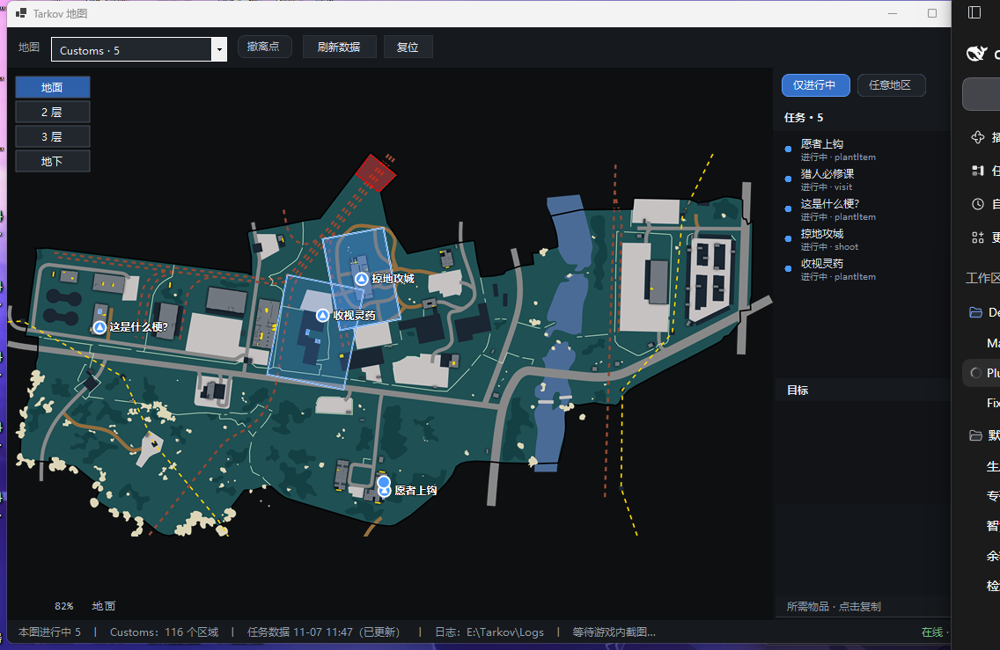
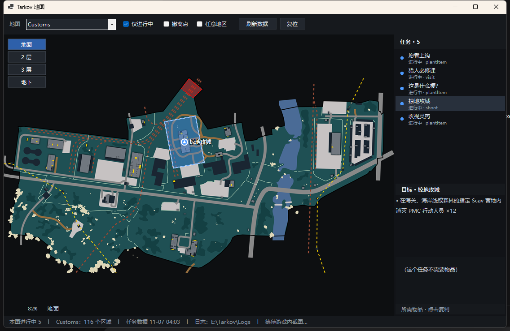
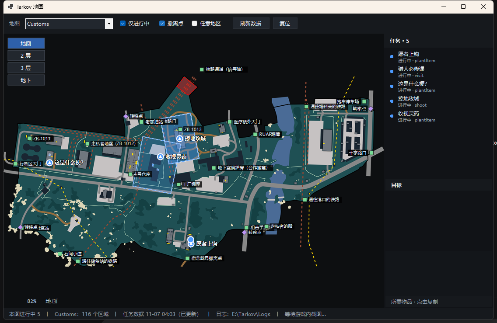
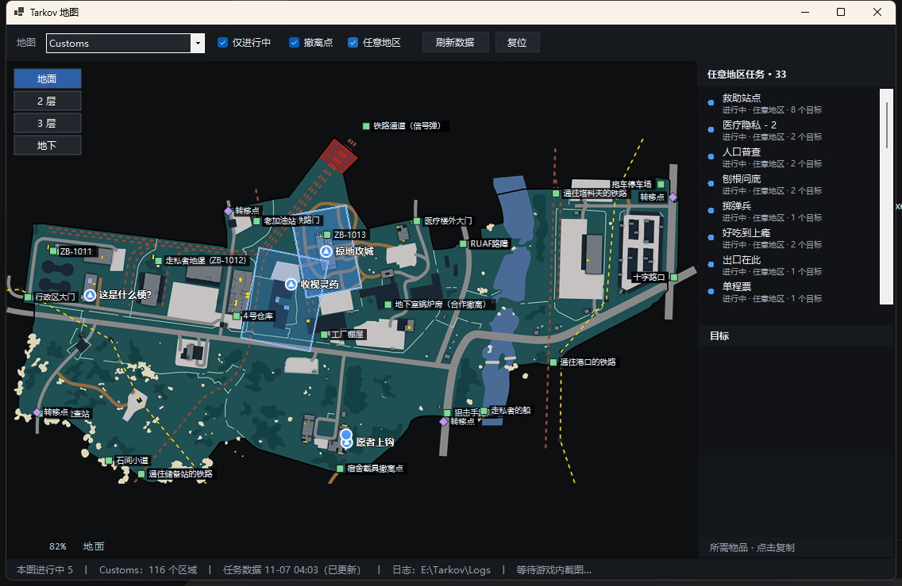
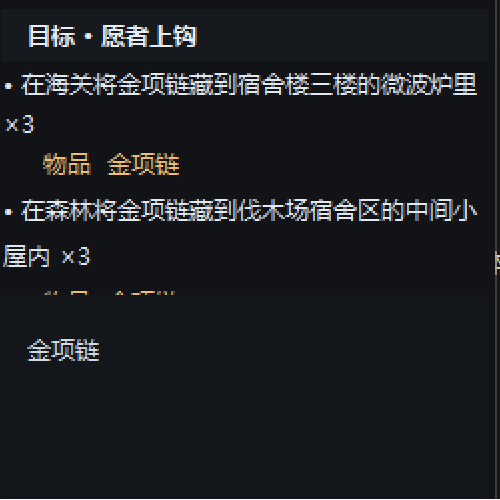

# TarkovMapLite

任务维护：主窗口底部可手工编辑任务、目标、点位与区域，保存独立 JSON 到 Git 工作目录，并从 Raw / Pages 地址读取修订。详见 [手工维护说明](docs/task-authoring.md)。

一个给《逃离塔科夫》用的**原生小地图工具**：跟着日志自动切图、把进行中的任务区域画在地图上、显示所需物品与撤离点。
单文件 exe，不需要浏览器内核，从缓存启动内存占用约 120 MB（刚刷新数据时会到 200 MB 左右）。

A tiny **native** map companion for *Escape from Tarkov*: follows the game log to
switch maps automatically, draws the zones of your in-progress tasks, lists the
items they need, and shows every extract.



---

## 中文

### 为什么有它

塔科夫社区有 [TarkovMonitor](https://github.com/the-hideout/TarkovMonitor) 这样的工具，功能很全，但它用 BlazorWebView，一个进程就占 200 MB 上下，还带一整套 Chromium。机器只有 16 GB 的时候，游戏本身已经很吃内存了。

这个工具只做地图这件事，用 WinForms + GDI+ 自己画：启动快、占内存小、没有浏览器内核。

### 功能

任务面板支持按地区、状态、商人、目标类别、阵营、角色等级、Kappa 和灯塔商人必需性组合筛选。搜索任务名、目标、商人、物品或钥匙，空格分隔的词需要全部匹配。电脑与手机共用筛选结果，默认跟随当前地图；选择跨图任务后，可在详情中点击“前往……”切图。

角色等级仅检查最低等级要求，不表示任务已经解锁。没有日志记录显示“日志未记录”；缺失的元数据保留未知，不能匹配等级、阵营或必需性条件。面板显示补充元数据的实际快照日期；搜索词只在本次运行保留，其余筛选条件会保存。

任务坐标缺失时会按任务与目标 ID 合并内置位置快照，旧缓存无需删除即可补全。选中任务可预览其点位，不受“任务区域：仅进行中”的状态过滤限制；取消选中后恢复过滤，原有图层开关与“本图已完成”隐藏仍然有效。坐标覆盖与异常记录说明见 [任务坐标验证](docs/task-locations-verification.md)。

任务描述与所需物品放在任务列表左侧的侧滑详情中，选中展开、取消选中收起，支持关闭按钮和 Esc。多点任务总览保留名称与序号，仅选中后显示当前楼层的关联线；同一目标的候选刷新点单独标注，避免误以为需要逐一前往。

主线任务归为独立“商人”，可按系列浏览子任务。点击“主线：关闭”或明确选择“主线任务”商人后手动开启，再选择需要的系列；橙红色点位与商人任务区域区分。主线每次启动默认关闭，不从游戏日志读取或自动更新进度。无可靠坐标的子任务保留完整说明；缺少底图的地点显示“底图未收录”。

显示偏好会自动保存在 `%LOCALAPPDATA%\TarkovMapLite\settings.json`：包括图层与子分类、任务筛选、撤离点，以及上次查看的地图版本和楼层。关闭后再次打开会恢复这些选择；玩家位置仍以当前对局的新截图为准。任务目标说明支持鼠标悬停后直接用滚轮滚动。

| 功能 | 说明 |
| --- | --- |
| 自动切图 | 读 `Logs\*.log` 里的 `scene preset path`，进图自动切到对应地图（含 Streets、Interchange、Reserve 等触发名不同步的图） |
| 任务区域 | 按任务进度着色：进行中蓝、已完成绿、失败红、日志未记录灰；区域的“仅进行中”开关在图层菜单，与列表筛选独立 |
| 楼层 | 每层一张位图，切换楼层时压暗地面再叠当前层；任务点位带上下箭头提示 |
| 楼层提示 | 左下角显示当前楼层与缩放（如 `82% 地面`） |
| 单选任务 | 选中任务后地图只显示它的区域；**再点一次取消**，恢复显示全部 |
| 任务地区 | 根据任务及目标的地图限制筛选；没有地图限制的归为任意地区，资料缺失的单列地区未知 |
| 所需物品 | 列出任务需要的物品/钥匙，**点一下复制**名字，直接去跳蚤市场搜；悬停有高亮反馈 |
| 候选刷新点 | 选中任务后，地图上用琥珀色点标出该物品在本图的可能生成位置 |
| 撤离点 / 转移点 | 开关一键显示，绿色方块=撤离点、紫色菱形=转移点，名字走中文翻译表 |
| 玩家位置 | 读截图文件名里的坐标与朝向，在地图上画一个带方向的箭头；换图后旧位置自动隐藏 |
| **玩家楼层** | 截图文件名里还有高度：楼层按钮旁标青点，玩家不在当前层时标记半透明，状态栏写「（2 层）」 |
| **手机端** | 顶栏「手机端」弹二维码，手机浏览器扫一下当第二屏；电脑算投影、手机只画，位置永远一致 |
| **门锁 / 闸点** | 237 个需要钥匙的门 + 39 个闸；门悬停显示钥匙名、点一下复制，闸标出它开哪个撤离点 |
| **散落物资分类** | 钥匙 / 药品 / 食物 / 海报 / 收纳 / 杂物 / 文件，按类上色、单独开关 |
| **本图已完成** | 任务列表右键标记：跨图任务在别的图做完后，这张图上不再显示 |
| 离线可用 | 首次运行内置了一份任务/物品/地图数据快照；联网时自动更新，右下角常显数据来源 |

<table>
<tr>
<td></td>
<td></td>
</tr>
<tr>
<td></td>
<td></td>
</tr>
</table>

### 下载与使用

1. 到 [Releases](../../releases) 下载 `TarkovMapLite.exe`（单文件，约 126 MB，自带运行时）
2. 双击运行，不需要安装，不需要 .NET
3. 工具会自动找日志目录：`<游戏安装目录>\Logs`、`%LOCALAPPDATA%\Battlestate Games\...\Logs` 都会尝试
4. 截图目录默认 `<文档>\Escape From Tarkov\Screenshots`，可用环境变量 `TARKOVMAPLITE_SHOTS` 覆盖

**操作**：滚轮缩放、拖动平移、`R` 复位、`+/-` 缩放、点任务看详情、点物品名复制。

### 软件更新

从 0.4.12 开始，底部“软件更新”提供新版检查、说明、下载和安装。启动约 4 秒后在后台检查正式版，只在按钮上提示；不会自动下载、关闭地图或重启。点击“下载更新”后可关闭面板继续使用，校验完成后由你点击“重启并更新”。支持稍后、跳过当前版本，以及关闭启动检查。

更新连接可选择系统代理、直接连接或自定义 HTTP／HTTPS 代理，仅影响软件更新。检查或下载失败时可打开官方发布页面手动下载。旧版用户需要先手动换成支持更新的版本，之后才能收到程序内更新提示。

新版会验证文件大小、SHA-256、产品与版本，替换前保留旧程序；新版无法完成启动确认时尝试恢复并启动旧版。更新不会修改设置、手动标记或游戏文件。自动替换需要程序所在目录可写；备份保存在原 exe 旁。实现与验证见 [软件更新说明](docs/software-updates.md)。

### 数据来源与联网

- 任务/物品/商场：`https://json.tarkov.dev`（tarkov.dev 的公开接口，含中文翻译）
- 缓存写在 `%LOCALAPPDATA%\TarkovMapLite\data-v8.json`，超过 24 小时才刷新
- 断网也能用：exe 里打包了一份数据快照（`Assets/data-seed.json`）
- 右下角会显示 `在线 · 12:03` / `缓存 · 11-07 11:47` / `内置数据 · 11-07` / `无数据`

### 从源码构建

需要 .NET 10 SDK。

```powershell
dotnet publish -c Release -r win-x64 --self-contained true
```

产物是 `bin\Release\net10.0-windows\win-x64\publish\TarkovMapLite.exe`，单文件、约 126 MB。

### 开发文档

| 文件 | 内容 |
| --- | --- |
| **[docs/CODE-MAP.md](docs/CODE-MAP.md)** | **先看这个**：调用关系、四条数据链、改一件事要动哪几处、出问题查哪里、11 条历史坑 |
| [docs/DATA-RULES.md](docs/DATA-RULES.md) | tarkov.dev 接口字段与本地数据格式 |
| [docs/UI-RULES.md](docs/UI-RULES.md) | WinForms 的坑（菜单、ListBox、滚动条……） |
| [docs/MAP-FLOORS.md](docs/MAP-FLOORS.md) | 楼层来源、跨版本素材补齐、菜单更新与自动检查 |

每个 `.cs` 文件顶部还有一段头注释：这个文件负责什么、谁在用、改它会牵连什么。

> 手机端在 `v0.3.0` 起提供：`LocalServer.cs` / `MobileState.cs` / `Assets/mobile/`。

### 重新生成地图

地图 PNG 是预渲染的（不用在程序里解析 SVG）。想改分辨率或换 SVG：

```powershell
powershell -File tools\rasterize-maps.ps1              # 默认长边 4000 px
powershell -File tools\rasterize-maps.ps1 -MaxEdge 6000
```

脚本依赖本机的 Edge/Chrome 以 headless 模式渲染，输出到 `Assets/maps/`。
**脚本必须保持纯 ASCII**：Windows PowerShell 5.1 会把无 BOM 的 UTF-8 当 ANSI 读，中文注释会连带把后面的语句搞坏。

### 已知限制

- **楼层是推算的**：接口没有每层的高度区间，只能用区域高度中点相对地形除 3 米来估。个别任务会算错楼层，导致切层时箭头看起来没变化。这不是 bug，是数据缺失；要彻底解决得手工做一张校正表。
- 只支持 Windows。
- PVE 与 PVP 的进度各自独立，程序按 `Logs` 里最近一次进图判断，不区分模式。

### 免责声明

只读日志文件与截图文件名，不注入进程、不读写游戏内存、不模拟输入。
与 Battlestate Games 无任何关联，使用风险自负。素材与数据来源见 [NOTICE](NOTICE)。

---

## English

A native Windows map companion for *Escape from Tarkov* — no browser engine, ~115 MB
resident memory from cache, single-file exe.

**What it does**

- Watches the game log and switches to the map you're actually loading into
- Draws the zones of your in-progress tasks, colour-coded by task state
- Per-floor bitmaps with the ground dimmed underneath; markers carry up/down
  arrows when a task is on another floor
- Click a task to show only its zones (click again to clear)
- Task regions come from task/objective map restrictions; missing coordinates do not imply an unrestricted region. Unknown metadata remains unknown.
- Required items click-to-copy (handy for flea market search), with candidate
  loot spawn points drawn on the map
- Extract / transit overlay with Chinese names
- Player position and heading recovered from screenshot file names

**Download**: grab `TarkovMapLite.exe` from [Releases](../../releases) and run it.
Nothing to install; .NET is bundled.

**Build**: `dotnet publish -c Release -r win-x64 --self-contained true` (.NET 10 SDK).

**Hacking on it**: read [docs/CODE-MAP.md](docs/CODE-MAP.md) first — call graph, the four
data pipelines, "change A also touch B" table, and a troubleshooting table. Every source
file also starts with a header comment (owner, callers, what breaks if you change it).

**Data**: task/item/map data comes from `json.tarkov.dev` and is cached for 24 h; a
snapshot is embedded so the tool works offline on first run.

**Licence**: MIT for the code, see [LICENSE](LICENSE); bundled artwork and game data
are third-party, see [NOTICE](NOTICE). Not affiliated with Battlestate Games.
