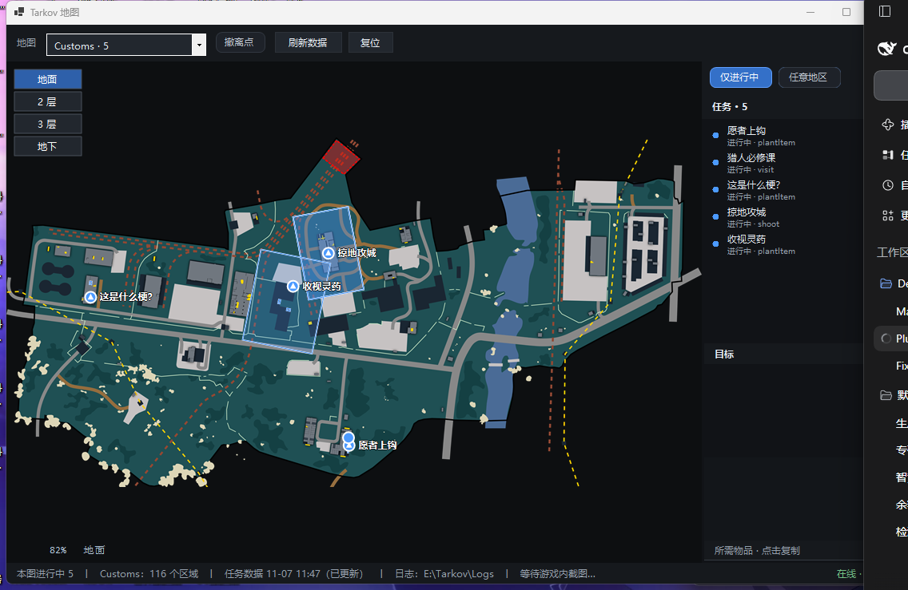
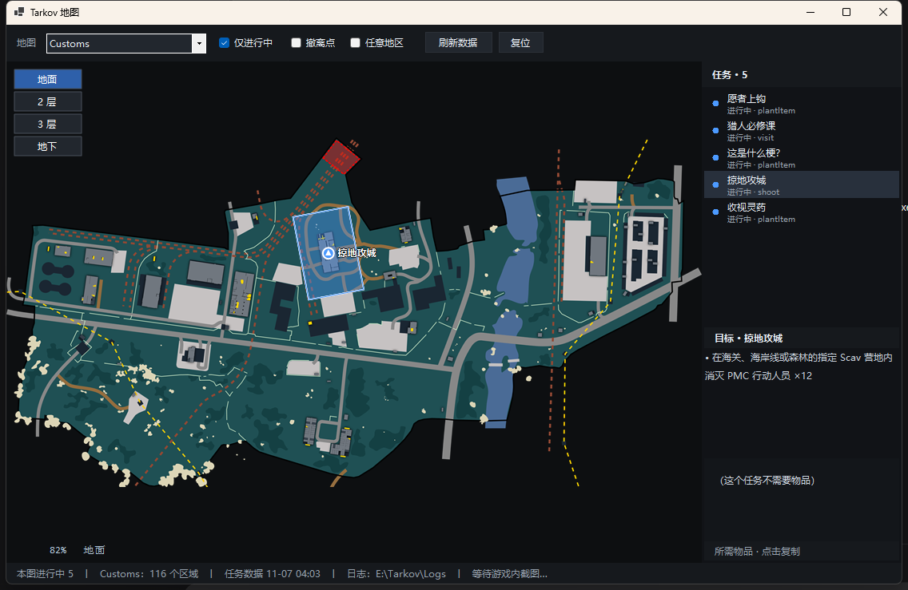
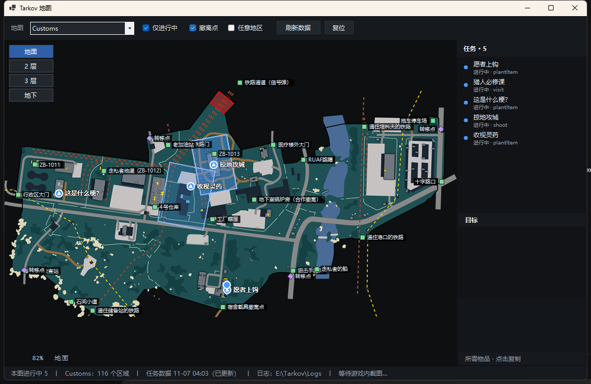
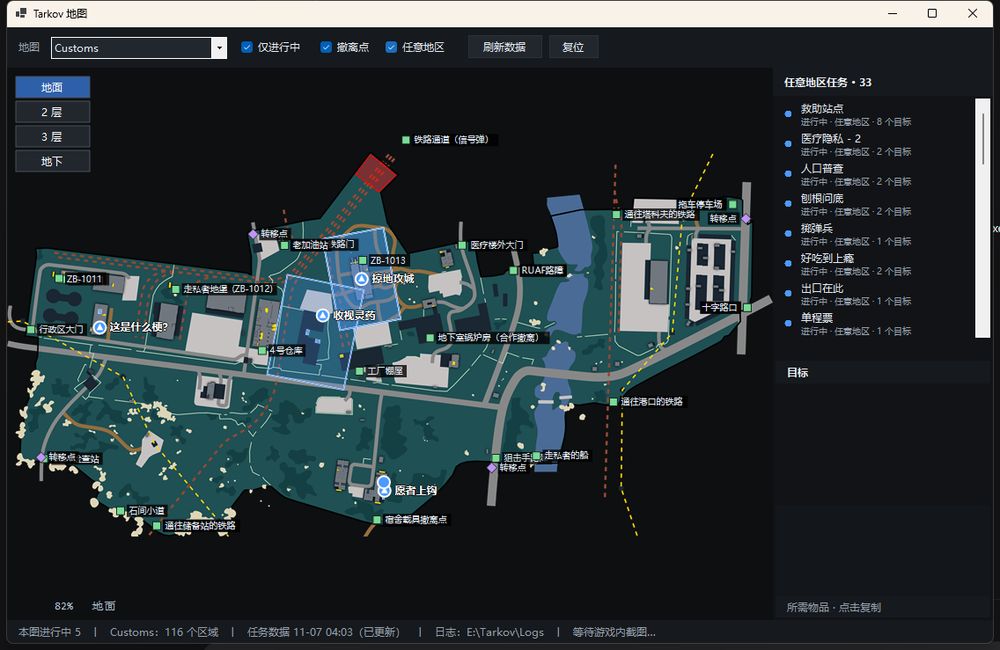
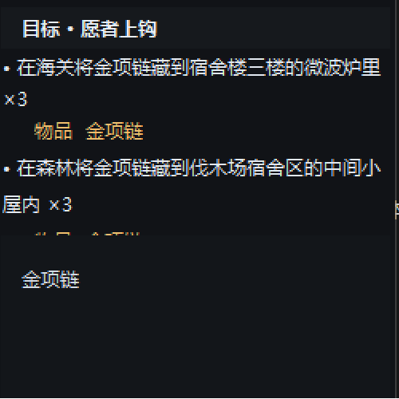

# TarkovMapLite

一个给《逃离塔科夫》用的**原生小地图工具**：跟着日志自动切图、把进行中的任务区域画在地图上、显示所需物品与撤离点。
单文件 exe，不需要浏览器内核，从缓存启动内存占用约 120 MB（刚刷新数据时会到 200 MB 左右）。

A tiny **native** map companion for *Escape from Tarkov*: follows the game log to
switch maps automatically, draws the zones of your in-progress tasks, lists the
items they need, and shows every extract.



---

## 中文

### 为什么有它

塔科夫社区有 [TarkovMonitor](https://github.com/the-hideout/TarkovMonitor) 这样的工具，功能很全，但它用 BlazorWebView，一个进程就占 200 MB 上下，还带一整套 Chromium。机器只有 16 GB 的时候，游戏本身已经很吃内存了。

这个工具只做地图这件事，用 WinForms + GDI+ 自己画：启动快、占内存小、没有浏览器内核。

### 功能

| 功能 | 说明 |
| --- | --- |
| 自动切图 | 读 `Logs\*.log` 里的 `scene preset path`，进图自动切到对应地图（含 Streets、Interchange、Reserve 等触发名不同步的图） |
| 任务区域 | 按任务进度着色：进行中蓝、已完成绿、失败红、未开始灰 |
| 楼层 | 每层一张位图，切换楼层时压暗地面再叠当前层；任务点位带上下箭头提示 |
| 楼层提示 | 左下角显示当前楼层与缩放（如 `82% 地面`） |
| 单选任务 | 选中任务后地图只显示它的区域；**再点一次取消**，恢复显示全部 |
| 任意地区任务 | 没有任何区域但有目标的任务（33 个左右）单独归类，仍可查看目标与所需物品 |
| 所需物品 | 列出任务需要的物品/钥匙，**点一下复制**名字，直接去跳蚤市场搜；悬停有高亮反馈 |
| 候选刷新点 | 选中任务后，地图上用琥珀色点标出该物品在本图的可能生成位置 |
| 撤离点 / 转移点 | 开关一键显示，绿色方块=撤离点、紫色菱形=转移点，名字走中文翻译表 |
| 玩家位置 | 读截图文件名里的坐标与朝向，在地图上画一个带方向的箭头；换图后旧位置自动隐藏 |
| 离线可用 | 首次运行内置了一份任务/物品/地图数据快照；联网时自动更新，右下角常显数据来源 |

<table>
<tr>
<td></td>
<td></td>
</tr>
<tr>
<td></td>
<td></td>
</tr>
</table>

### 下载与使用

1. 到 [Releases](../../releases) 下载 `TarkovMapLite.exe`（单文件，约 79 MB，自带运行时）
2. 双击运行，不需要安装，不需要 .NET
3. 工具会自动找日志目录：`<游戏安装目录>\Logs`、`%LOCALAPPDATA%\Battlestate Games\...\Logs` 都会尝试
4. 截图目录默认 `<文档>\Escape From Tarkov\Screenshots`，可用环境变量 `TARKOVMAPLITE_SHOTS` 覆盖

**操作**：滚轮缩放、拖动平移、`R` 复位、`+/-` 缩放、点任务看详情、点物品名复制。

### 数据来源与联网

- 任务/物品/商场：`https://json.tarkov.dev`（tarkov.dev 的公开接口，含中文翻译）
- 缓存写在 `%LOCALAPPDATA%\TarkovMapLite\data-v5.json`，超过 24 小时才刷新
- 断网也能用：exe 里打包了一份数据快照（`Assets/data-seed.json`）
- 右下角会显示 `在线 · 12:03` / `缓存 · 11-07 11:47` / `内置数据 · 11-07` / `无数据`

### 从源码构建

需要 .NET 10 SDK。

```powershell
dotnet publish -c Release -r win-x64 --self-contained true
```

产物是 `bin\Release\net10.0-windows\win-x64\publish\TarkovMapLite.exe`，单文件、约 79 MB。

### 重新生成地图

地图 PNG 是预渲染的（不用在程序里解析 SVG）。想改分辨率或换 SVG：

```powershell
powershell -File tools\rasterize-maps.ps1              # 默认长边 4000 px
powershell -File tools\rasterize-maps.ps1 -MaxEdge 6000
```

脚本依赖本机的 Edge/Chrome 以 headless 模式渲染，输出到 `Assets/maps/`。
**脚本必须保持纯 ASCII**：Windows PowerShell 5.1 会把无 BOM 的 UTF-8 当 ANSI 读，中文注释会连带把后面的语句搞坏。

### 已知限制

- **楼层是推算的**：接口没有每层的高度区间，只能用区域高度中点相对地形除 3 米来估。个别任务会算错楼层，导致切层时箭头看起来没变化。这不是 bug，是数据缺失；要彻底解决得手工做一张校正表。
- 只支持 Windows。
- PVE 与 PVP 的进度各自独立，程序按 `Logs` 里最近一次进图判断，不区分模式。

### 免责声明

只读日志文件与截图文件名，不注入进程、不读写游戏内存、不模拟输入。
与 Battlestate Games 无任何关联，使用风险自负。素材与数据来源见 [NOTICE](NOTICE)。

---

## English

A native Windows map companion for *Escape from Tarkov* — no browser engine, ~115 MB
resident memory from cache, single-file exe.

**What it does**

- Watches the game log and switches to the map you're actually loading into
- Draws the zones of your in-progress tasks, colour-coded by task state
- Per-floor bitmaps with the ground dimmed underneath; markers carry up/down
  arrows when a task is on another floor
- Click a task to show only its zones (click again to clear)
- Tasks with objectives but no zone anywhere are grouped under "任意地区"
- Required items click-to-copy (handy for flea market search), with candidate
  loot spawn points drawn on the map
- Extract / transit overlay with Chinese names
- Player position and heading recovered from screenshot file names

**Download**: grab `TarkovMapLite.exe` from [Releases](../../releases) and run it.
Nothing to install; .NET is bundled.

**Build**: `dotnet publish -c Release -r win-x64 --self-contained true` (.NET 10 SDK).

**Data**: task/item/map data comes from `json.tarkov.dev` and is cached for 24 h; a
snapshot is embedded so the tool works offline on first run.

**Licence**: MIT for the code, see [LICENSE](LICENSE); bundled artwork and game data
are third-party, see [NOTICE](NOTICE). Not affiliated with Battlestate Games.
